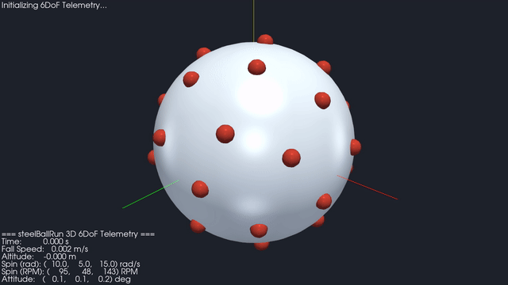
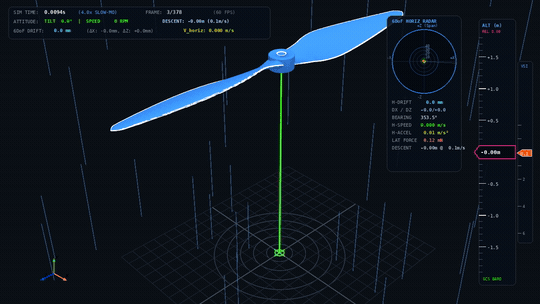
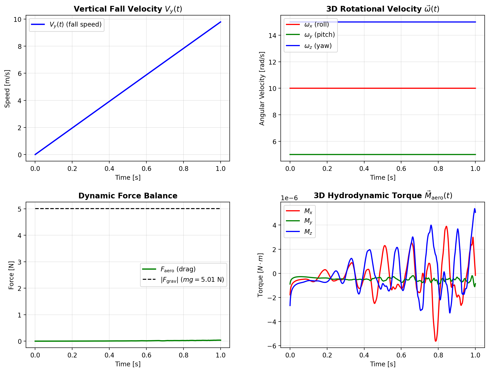
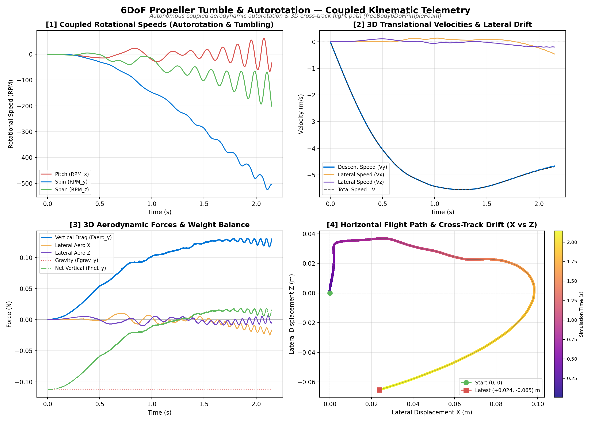
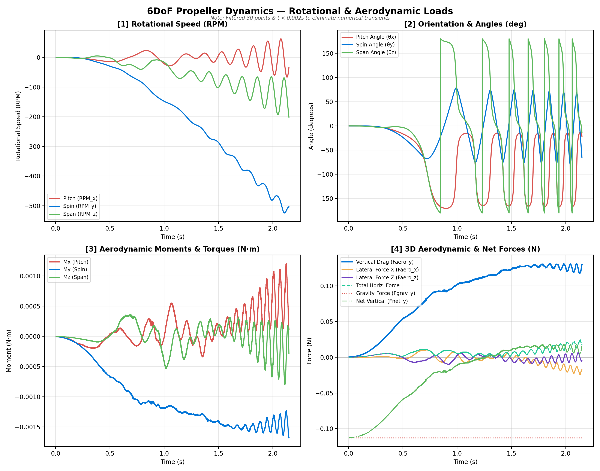
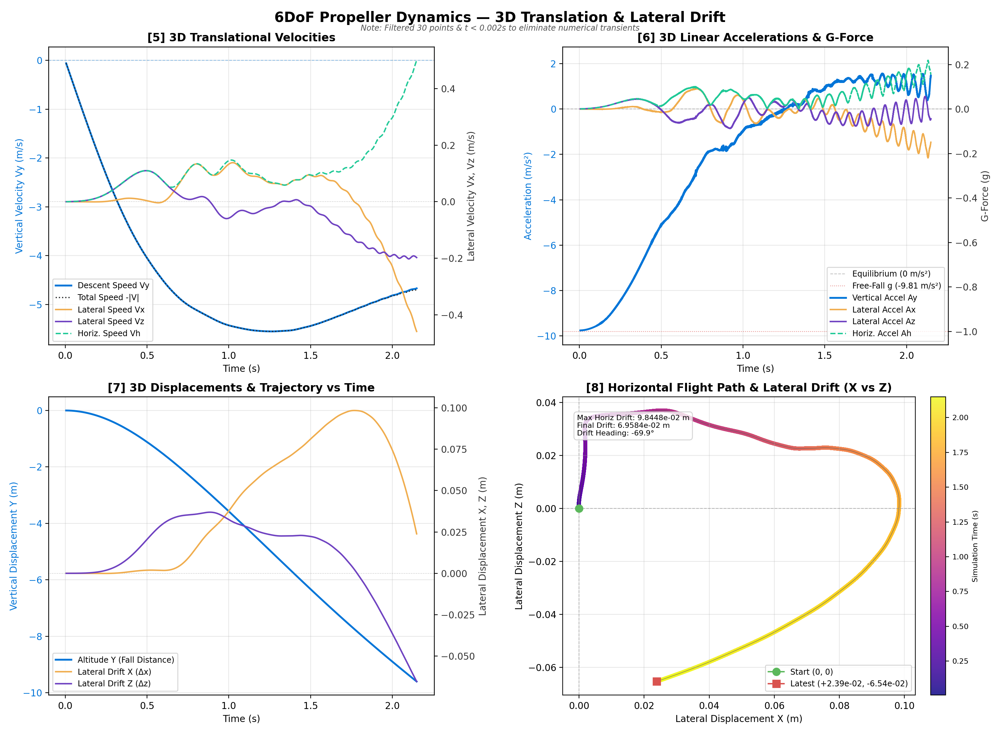

# freeBodyFoam

[](https://github.com/chinmay-s-patil/freeBodyFoam/actions/workflows/ci.yml)
[](https://www.openfoam.com)
[](https://github.com/chinmay-s-patil/freeBodyFoam/actions/workflows/docker.yml)
[](https://github.com/chinmay-s-patil/freeBodyFoam/pkgs/container/freebodyfoam)
[](LICENSE)
[](docs/validation.md)

`freeBodyFoam` is a custom OpenFOAM solver suite for simulating free-falling bodies, projectile trajectories, atmospheric entry, and 6DoF tumbling dynamics in a body-fixed accelerating reference frame. By solving fluid dynamics in the non-inertial frame of the falling object, trajectory descents across kilometers of physical altitude are resolved within a compact, stationary computational domain.

<table>
  <tr>
    <th width="50%" style="text-align:center;">3D 6DoF Sphere Tumbling (<a href="#3d-6dof-showcase-steelballrun"><code>steelBallRun</code> Tutorial</a>)</th>
    <th width="50%" style="text-align:center;">6DoF Propeller Tumble &amp; Autorotation (<a href="#6dof-propeller-tumble--autorotation">Case Study</a>)</th>
  </tr>
  <tr>
    <td align="center">
      
    </td>
    <td align="center">
      
    </td>
  </tr>
</table>

### Scope and Validation Summary

* **Verified (incompressible 3DoF / 6DoF):** RK4 rotational ODE integration ($p = 3.991$, vacuum invariant drift $< 10^{-14}$), non-inertial frame momentum coupling ($F_{\mathrm{aero}}/mg = 99.97\%$ in `theRodDrop-Denser`), sliding `cyclicAMI` flux conservation ($< 4.8 \times 10^{-13}\text{ m}^3/\text{s}$), and free-settling sphere speed against Uhlmann & Dušek (2014) ($-1.0\%$, buoyancy enabled).
* **Tumbling disk benchmark (Tinklenberg et al. 2023):** Strouhal number matches ($St = 0.0593$ vs. $0.055\text{--}0.060$ exp.) with bounded numerical uncertainty ($u_{\mathrm{num}} \le 0.93\%$ at $Re = 100$), while terminal settling velocity is $17\%$ lower than experiment (not validated for mean terminal speed).
* **Experimental / unvalidated:** Compressible solvers (`freeBodyRhoPimpleFoam`, `freeBodyRhoCentralFoam`), `externalForces` models (`constant`, `tabulated`, `thrust`, `sixDoFThrust`), and `powerLaw`/`tabulated` `meanFlowModel` profiles are compiled without public tutorials or validation cases. `libsixDoFRotatingMotion.so` is tested in the private `propFall` case suite, but remains unvalidated in the public benchmark suite.
* **Automated tests:** CI runs Python verification/consistency checks, Markdown link checks, and a short `theRodDrop` smoke run.

Details and convergence data are in [docs/validation.md](docs/validation.md#1-validation-status--asme-vv-20-overview).

---

## Solvers Overview

| Solver | Flow Regime | Degrees of Freedom | Status |
| :--- | :--- | :--- | :--- |
| `freeBodyPimpleFoam` | Incompressible (body-fixed) | 3D Translation | Verified (frame coupling) |
| `freeBody6DoFPimpleFoam` | Incompressible (body-fixed) | 6DoF (Translation + Rotation) | Verified (kinematics & AMI) |
| `freeBodyRhoPimpleFoam` | Compressible (body-fixed) | 3D Translation | Experimental (untested) |
| `freeBodyRhoCentralFoam` | Transonic / Supersonic (body-fixed) | 3D Translation | Experimental (untested) |

### Compiled Libraries

| Library | Contents | Status |
| :--- | :--- | :--- |
| `libfallingInletVelocity.so` | Frame-coupled inlet velocity BC (`fallingInletVelocity`) | Verified |
| `libfreeBodyRotationalMotion.so` | 6DoF quaternion solid-body motion (`freeBodyRotationalMotion`) | Verified |
| `libfreeFallingFunctionObjects.so` | Runtime trajectory and load logger (`fallingMotion`) | Verified |
| `libfreeFallingModels.so` | `meanFlowModel` (`constant`, `powerLaw`, `tabulated`) and `externalForces` (`constant`, `tabulated`, `thrust`, `sixDoFThrust`) | Partial (`constant` mean flow only; others untested) |
| `libsixDoFRotatingMotion.so` | Alternative 6DoF rotating motion solver (`sixDoFRotatingMotion`) | Unvalidated (tested in private `propFall` case suite) |

---

## Numerical Method

Instead of translating the entire mesh or meshing kilometers of descent altitude, `freeBodyFoam` solves the flow in a body-fixed frame:

1. **Body-Fixed Accelerating Reference Frame**: Incorporates the d'Alembert fictitious inertial force $\mathbf{S}_U = -\mathbf{a}_{\text{frame}}$ directly into the momentum equation:
   $$\frac{\partial \mathbf{U}}{\partial t} + \nabla \cdot (\mathbf{U} \mathbf{U}) - \nabla \cdot (\nu_{\text{eff}} \nabla \mathbf{U}) = -\frac{1}{\rho_f} \nabla p + \mathbf{g} - \mathbf{a}_{\text{frame}}$$
2. **Hydrostatic-Reduced Pressure Formulation ($p_{\text{rgh}}$)**: Eliminates hydrostatic head terms from the momentum equation, preserving numerical stability. Total surface pressure $p = p_{\text{rgh}} + \rho_f (\mathbf{g} - \mathbf{a}_{\text{frame}}) \cdot \mathbf{r}$ is reconstructed on body patches via `includeBuoyancy true` (default) to capture Archimedean and apparent buoyancy, or omitted via `includeBuoyancy false` for pure aerodynamic pressure integration.
3. **Dynamic Inflow/Outflow Switching (`fallingInletVelocity`)**: Evaluates instantaneous directional face fluxes $(\mathbf{S}_f \cdot \mathbf{U}_{\text{inlet}})$, imposing Dirichlet inflow conditions on upstream faces and reflection-free zero-gradient Neumann conditions on downstream wake faces.
4. **Coupled 6DoF Quaternion Kinematics**: Integrates Euler's rigid-body equations for angular velocity $\boldsymbol{\omega}$ with explicit RK4 ($p = 3.991$) and orientation via exponential quaternion map on $SO(3)$. Truncation-level drift is $< 10^{-14}$ across 13,333 steps at $\Delta t = 1.5 \times 10^{-5}\text{ s}$ in vacuum (scaling as $\mathcal{O}(\Delta t^4)$; RK4 is explicit and non-symplectic).
5. **Arbitrary Mesh Interface (`cyclicAMI`) for Arbitrary 3D Tumble**: Combines an inner rotating spherical mesh zone (`rotatingZone`) with an outer stationary domain, allowing continuous, unconstrained 3D tumbling without remeshing.

---

## Benchmark Showcases & Validation

* **Frame Momentum Coupling (`theRodDrop-Denser`):** Half-cylinder URANS ($Re = 2.57 \times 10^7$) reaches $V_{\text{sim}} = 96.34\text{ m/s}$ vs. $96.36\text{ m/s}$ analytical ($-0.02\%$, $F_{\mathrm{aero}}/mg = 99.97\%$, `includeBuoyancy true`). Verifies accelerating-frame balance from simulated $C_D = 0.3452$.
* **Spectral Sphere Free Settling ([Uhlmann & Dušek 2014](https://doi.org/10.1016/j.ijmultiphaseflow.2013.10.010)):** Free settling at $G = 144, Re = 185$ yields $V = -0.900\text{ m/s}$ vs. spectral $-0.909\text{ m/s}$ ($-1.0\%$, buoyancy $\approx 67\%$ of weight). Reproducible in seconds from tracked `motion.dat` via `python3 validation/uhlmann_sphere/analyze_caseA_free.py validation/uhlmann_sphere/caseA_free_G144`.
* **Thin Disk Tumbling ([Tinklenberg et al. 2023](https://doi.org/10.1017/jfm.2023.209)):** Sustained 13-revolution autorotation matches experimental Strouhal number ($St = 0.0593$ vs. $0.055\text{--}0.060$) with $u_{\mathrm{num}} \le 0.93\%$ ($Re = 100$ GCI), while mean settling speed shows a $-17\%$ deficit.
* **Viscous Disk Flow ([Fernandes et al. 2007](https://doi.org/10.1017/S0022112006003685)):** Partial setup (`case_Re100_release` and fixed-body `case_Re200_fixed`); onset thresholds ($Re_c$) remain unvalidated.

See **[docs/validation.md](docs/validation.md)** for derivations, plots, ASME V&V 20 uncertainty budgets, and reproducible verification scripts (also in [`validation/report.pdf`](validation/report.pdf)).

---

## Tutorial Suite

The repository includes three documented tutorial cases:

```
tutorials/
├── theRodDrop/     # 2D planar transverse cylinder free-fall
│                   # & analytical terminal velocity verification
├── rodRoller/      # 2D cylinder with axial Z-spin via
│                   # circular sliding cyclicAMI (O-grid)
└── steelBallRun/   # True 3D solid sphere with unconstrained
                    # 6DoF motion & 32-dot Fibonacci visual markers
```

### 3D 6DoF Showcase: `steelBallRun`
Simulates a solid steel sphere ($D = 50\text{ mm}$, $m = 0.5105\text{ kg}$) falling under planetary gravity with unrestricted 3D translation and 3D tumbling ($\vec{\omega}_0 = (10, 5, 15)\text{ rad/s}$), rendered at the top of this README with 32 Fibonacci surface markers:

<p align="center">
  
</p>

* Real-time terminal dashboard: `python3 track_motion.py --watch`
* Kinematics plot: `python3 track_motion.py --plot`
* 3D PyVista animation: `python3 animate_motion.py --video steelBallRun.mp4`

---

## 6DoF Propeller Tumble & Autorotation

> Note: This propeller aerodynamic tumble simulation is a private research case study showcasing `freeBody6DoFPimpleFoam`. While the propeller geometry and case files are kept private, the animation above and telemetry below illustrate the coupled 6DoF dynamics resolved by the solver.

<p align="center">
  
</p>

<details>
<summary>Click to expand full 8-panel Rotational and Translational reports (Side-by-Side)</summary>
<br/>

<table>
  <tr>
    <th width="50%" style="text-align:center;">Rotational Dynamics & Aerodynamic Loads</th>
    <th width="50%" style="text-align:center;">3D Trajectory & Lateral Drift Kinematics</th>
  </tr>
  <tr>
    <td align="center">
      
    </td>
    <td align="center">
      
    </td>
  </tr>
</table>

</details>

### Capabilities Demonstrated
* Full 6DoF coupled tumble and autorotation: blade autorotation, gyroscopic tumbling, pitch reversal, and 3D crosswind drift on non-trivial geometries.
* Non-deforming sliding spherical mesh (`cyclicAMI`): continuous, unrestricted multi-axis 3D tumbling without mesh skewness degradation or remeshing penalties.
* Pressure and viscous moment integration: instantaneous $p_{\text{rgh}}$ and viscous shear stress across complex lifting surfaces.
* Precision telemetry: real-time 6DoF pose quaternions, Euler attitude angles, velocity, acceleration, and force balances.

## Requirements and Environment

* **OpenFOAM**: Tested on OpenFOAM v2412 (Ubuntu 24.04 LTS x86_64, GCC 13.3).
* **Python**: Python 3.11+ with NumPy, Matplotlib, and PyVista (for live telemetry, plot scripts, and 3D video renders).

---

## Build Instructions

Source your OpenFOAM installation and compile with `./Allwmake`:

```bash
# Source OpenFOAM environment
source /usr/lib/openfoam/openfoam2412/etc/bashrc

# Compile boundary conditions, motion solvers, function objects, and solvers
./Allwmake
```

Compiled libraries (`libfallingInletVelocity.so`, `libfreeFallingModels.so`, `libfreeFallingFunctionObjects.so`, `libfreeBodyRotationalMotion.so`, `libsixDoFRotatingMotion.so`) are placed into `$FOAM_USER_LIBBIN`. Solver binaries (`freeBodyPimpleFoam`, `freeBody6DoFPimpleFoam`, `freeBodyRhoPimpleFoam`, `freeBodyRhoCentralFoam`) and `writeFFDict` are installed into `$FOAM_USER_APPBIN`. To clean build artifacts, run `./Allwclean`.

### Running with Docker

A container image pre-equipped with OpenFOAM-v2412 and compiled `freeBodyFoam` solvers is available via GitHub Container Registry:

```bash
# Pull and start an interactive simulation shell mounting current directory
docker run --rm -it -v "$PWD":/home/openfoam/run -w /home/openfoam/run \
    ghcr.io/chinmay-s-patil/freebodyfoam:latest
```

---

## Quick Start: Running Tutorials

Navigate to any tutorial and launch the automated runner:

```bash
# 1. Run theRodDrop-Denser (dense-fluid frame coupling showcase; base air case is in tutorials/theRodDrop/theRodDrop)
cd tutorials/theRodDrop/theRodDrop-Denser
./Allrun

# 2. Run rodRoller (2D transverse cylinder with axial spin)
cd tutorials/rodRoller
./Allrun

# 3. Run steelBallRun (true 3D 6DoF steel sphere)
cd tutorials/steelBallRun
./Allrun
```

---

## Documentation Index

Detailed reference documentation is maintained in the [`docs/`](docs/) directory:

| Document | Description |
| :--- | :--- |
| [`docs/models.md`](docs/models.md) | Governing equations, accelerating reference frame transformations, $p_{\text{rgh}}$ derivation, and 6DoF quaternion dynamics |
| [`docs/dictionary.md`](docs/dictionary.md) | Keyword reference tables, physical units, and minimal working templates for `fallingFrameDict` and `dynamicMeshDict` |
| [`docs/tutorials.md`](docs/tutorials.md) | Walkthrough, meshing topologies, and kinematics plots for `theRodDrop`, `rodRoller`, and `steelBallRun` |
| [`docs/validation.md`](docs/validation.md) | Verification hierarchy, ASME V&V 20 convergence data, analytical terminal velocity comparisons, and Fernandes (2007) benchmarks |
| [`docs/development.md`](docs/development.md) | Source tree breakdown, PIMPLE predictor-corrector sequence, and instructions for developer extensions |

---

## References

* Clift, R., Grace, J. R., & Weber, M. E. (1978). *Bubbles, Drops, and Particles*. Academic Press, New York.
* Fernandes, P. C., Risso, F., Ern, P., & Magnaudet, J. (2007). "Oscillatory motion and wake instability of freely rising axisymmetric bodies". *Journal of Fluid Mechanics*, 573: 479–502.
* Jenny, M., Dušek, J., & Bouchet, G. (2004). "Instabilities and transition of a sphere freely falling or ascending in a fluid". *Journal of Fluid Mechanics*, 508: 201–239.
* Kurganov, A., & Tadmor, E. (2000). "New High-Resolution Central Schemes for Nonlinear Conservation Laws and Convection-Diffusion Equations". *Journal of Computational Physics*, 160(1): 241–282.
* Roache, P. J. (1998). *Verification and Validation in Computational Science and Engineering*. Hermosa Publishers, Albuquerque, NM.
* Roos, F. W., & Willmarth, W. W. (1971). "Some experimental results on sphere and disk drag". *AIAA Journal*, 9(2): 285–291.
* Schiller, L., & Naumann, A. (1933). "A drag coefficient correlation". *VDI Zeitung*, 77: 318–320.
* Shenoy, A. R., & Kleinstreuer, C. (2008). "Flow over a thin circular disk at low-to-moderate Reynolds numbers". *Journal of Fluid Mechanics*, 605: 253–262.
* Tinklenberg, A., Guala, M., & Coletti, F. (2023). "Thin disks falling in air". *Journal of Fluid Mechanics*, 962: A3.
* Uhlmann, M., & Dušek, J. (2014). "The motion of a single heavy sphere in ambient fluid: A benchmark for interface-resolved particulate flow simulations with significant relative velocities". *International Journal of Multiphase Flow*, 59: 221–243. [DOI: 10.1016/j.ijmultiphaseflow.2013.10.010](https://doi.org/10.1016/j.ijmultiphaseflow.2013.10.010).
* ASME V&V 20-2009: *Standard for Verification and Validation in Computational Fluid Dynamics and Heat Transfer*. American Society of Mechanical Engineers, New York.

---

## License and Trademark Notice

`freeBodyFoam` is free software licensed under GPL-3.0-or-later; see [`LICENSE`](LICENSE).

OPENFOAM® is a registered trade mark of OpenCFD Limited, producer and distributor of the OpenFOAM software via www.openfoam.com. This offering is not approved or endorsed by OpenCFD Limited.

