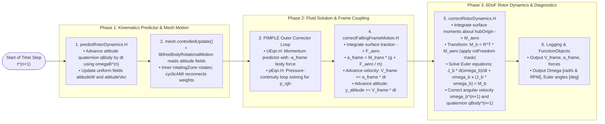

# Developer & Solver Architecture Guide

Architecture, execution sequence, numerical coupling, and source tree organization for `freeBodyFoam`.

---

## 1. Source Tree Structure

```
src/
├── BCs/                                # Boundary condition libraries
│   └── fallingInletVelocity/           # Dynamic accelerating frame inlet BC (libfallingInletVelocity.so)
│       ├── fallingInletVelocityFvPatchVectorField.C
│       └── fallingInletVelocityFvPatchVectorField.H
├── motion/                             # Dynamic mesh & sliding interface motion functions
│   ├── freeBodyRotationalMotion/       # 6DoF coupled solid-body motion solver (libfreeBodyRotationalMotion.so)
│   │   ├── freeBodyRotationalMotion.C
│   │   └── freeBodyRotationalMotion.H
│   └── sixDoFRotatingMotion/           # Alternative rotating motion library (libsixDoFRotatingMotion.so; tested in private propFall case, unvalidated)
├── models/                             # Shared physical models (libfreeFallingModels.so)
│   ├── meanFlowModel/                  # Inflow profiles (constant; powerLaw & tabulated are experimental)
│   └── externalForces/                 # Active external loads (constant, tabulated, thrust, sixDoFThrust — experimental)
├── functionObjects/                    # Diagnostic and logging function objects
│   └── fallingMotion/                  # Runtime trajectory and force monitor (libfreeFallingFunctionObjects.so)
├── solvers/                            # Free-falling dynamic solvers
│   ├── shared/                         # Shared predictor-corrector kinematics & logging headers
│   │   ├── createFallingFrameFields.H  # Reads fallingFrameDict and instantiates kinematics
│   │   ├── predictFallingFrameMotion.H # Step predictor for frame kinematics
│   │   └── correctFallingFrameMotion.H # Corrects frame acceleration & updates altitude
│   ├── freeBodyPimpleFoam/             # Incompressible transient solver (pure translation)
│   │   ├── freeBodyPimpleFoam.C
│   │   ├── UEqn.H                      # Momentum equation with -a_frame body force
│   │   └── pEqn.H                      # PIMPLE pressure equation
│   ├── freeBody6DoFPimpleFoam/         # 6DoF coupled PIMPLE solver (translation + rotation)
│   │   ├── freeBody6DoFPimpleFoam.C
│   │   ├── createRotorState.H          # Quaternion & principal inertia initialization
│   │   ├── predictRotorDynamics.H      # Predictor step for rotor attitude qBody
│   │   ├── correctRotorDynamics.H      # Evaluates aerodynamic moments & integrates Euler equations
│   │   ├── UEqn.H
│   │   └── pEqn.H                      # Hydrostatic-reduced p_rgh formulation
│   ├── freeBodyRhoPimpleFoam/          # Pressure-based compressible solver (subsonic/transonic)
│   └── freeBodyRhoCentralFoam/         # Density-based central-upwind solver (supersonic re-entry)
└── utilities/
    └── writeFFDict/                    # Automatic dictionary generation utility
```

---

## 2. Solver Execution Sequence

### 2.1 PIMPLE Time-Step Lifecycle (`freeBody6DoFPimpleFoam.C`)

In each time step $\Delta t$, the solver couples non-inertial fluid dynamics with 6DoF rigid-body motion through a predictor-corrector sequence:



---

## 3. Master Compilation & Cleaning

### 3.1 Compilation
Source your OpenFOAM v2412 environment and build all libraries and solvers:

```bash
# Source OpenFOAM environment
source /usr/lib/openfoam/openfoam2412/etc/bashrc

# Master build script
./Allwmake
```

Compiled shared libraries are installed into `$FOAM_USER_LIBBIN`:
* `libfallingInletVelocity.so`
* `libfreeBodyRotationalMotion.so`
* `libfreeFallingModels.so`
* `libfreeFallingFunctionObjects.so`

Compiled application binaries are installed into `$FOAM_USER_APPBIN`:
* `freeBodyPimpleFoam`
* `freeBody6DoFPimpleFoam`
* `freeBodyRhoPimpleFoam`
* `freeBodyRhoCentralFoam`
* `writeFFDict`

### 3.2 Cleaning
To remove all intermediate compilation object files (`Make/linux*`, `lnInclude/`):

```bash
./Allwclean
```

---

## 4. Developer Extensions & Implementing Custom Models

`freeBodyFoam` provides run-time selectable model hierarchies that allow developers to implement custom physical models without modifying solver source code.

### 4.1 Custom Mean Flow Models (`meanFlowModel`)
To implement an atmospheric wind profile or custom altitude-dependent shear layer:
1. Inherit from `Foam::meanFlowModel` in `src/models/meanFlowModel/`.
2. Implement the virtual method:
   ```cpp
   virtual vector velocity(const scalar altitude) const = 0;
   ```
3. Register using the run-time selection macro:
   ```cpp
   addToRunTimeSelectionTable(meanFlowModel, myCustomWindModel, dictionary);
   ```

### 4.2 Custom External Force Models (`externalForceModel`)
To couple active propulsion, parachute deceleration, or control surface aerodynamics:
1. Inherit from `Foam::externalForceModel` in `src/models/externalForces/`.
2. Implement the evaluation method returning a `bodyLoad` container (holding global-frame `force` and `moment`):
   ```cpp
   virtual bodyLoad evaluate
   (
       const scalar t,
       const quaternion& q = quaternion::I
   ) const = 0;
   ```
   where `bodyLoad` provides:
   ```cpp
   vector force;   // Total force in global reference frame [N]
   vector moment;  // Total moment about centre of mass in global frame [N*m]
   ```
3. Register using the run-time selection macro:
   ```cpp
   addToRunTimeSelectionTable(externalForceModel, myCustomForceModel, dictionary);
   ```

### 4.3 Custom Boundary Conditions
To create specialized far-field or body-mounted boundary conditions:
1. Inherit from `mixedFvPatchField<vector>` or `fixedValueFvPatchField<vector>`.
2. Read the uniform frame kinematics registered in `runTime`:
   ```cpp
   const uniformDimensionedVectorField& frameVel =
       db().lookupObject<uniformDimensionedVectorField>("frameVelocity");
   ```
3. Implement `updateCoeffs()` to evaluate patch-face relative velocity and apply directional inflow/outflow switching.

